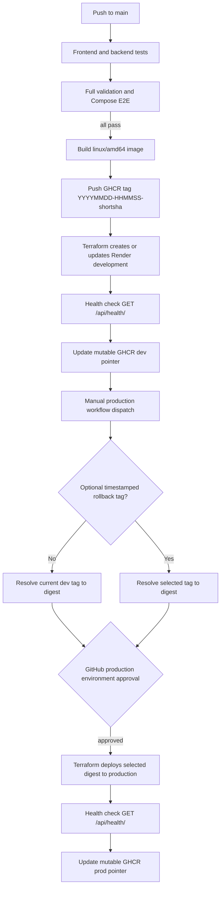

# Render deployment

Steadwork deploys to Render through Terraform. GitHub Actions builds one immutable container image after every required CI job passes and deploys it to development. After the dev health check passes, CI points the mutable `dev` tag at that exact image. The manually dispatched production workflow defaults to the image referenced by `dev`; an optional timestamped tag selects a rollback image. Production uses a GitHub Environment approval gate. Terraform Cloud (HCP Terraform) stores and locks remote state; the Render Terraform provider manages the Render project, its two environments, a PostgreSQL database, and the web service in each environment.

`render.yaml` is intentionally not used: it would define a second source of truth for services Terraform already manages. The container image is pushed to GHCR and built for `linux/amd64`. Workflows resolve a tag to its digest and deploy by digest, so a mutable tag cannot change the image midway through deployment. Timestamped tags remain available for diagnosis and rollback; `dev` and `prod` are convenience pointers to the last healthy deployment in each environment.

## Delivery flow



## One-time setup

1. Create an HCP Terraform organization and a user/team API token. This setup uses three workspaces: `steadwork-bootstrap`, `steadwork-dev`, and `steadwork-prod`.
2. In Render, create an API key and copy the owner ID from the account or team settings. The provider creates the Render project and development/production environments on the first apply.
3. Add the repository-level GitHub Actions secrets and variables listed below. Both deployment jobs need the Render and HCP Terraform credentials. If you prefer environment-scoped secrets, add the same `RENDER_API_KEY` and `TF_API_TOKEN` to both the `development` and `production` GitHub Environments; putting them only in `production` will prevent the dev deployment from authenticating.
4. In GitHub repository settings, create a `production` Environment and configure required reviewers. The environment gate is separate from Render's protected environment marker and is what pauses the workflow for human approval.
5. GHCR packages start private by default. Allow the first CI run to publish the image, change the package visibility to public in the package settings, then rerun the failed `deploy-dev` job. Render can then pull it without a registry credential. If the package must remain private, configure a Render registry credential separately and add its ID to the Terraform configuration.
6. Review Render plan selections and region before enabling deployments. The Terraform defaults use `free` web and PostgreSQL plans. **Because Render allows only one active free Postgres database per workspace, production deliberately reuses the development database to avoid a second database charge. Development and production therefore share the same data and schema.** Both services must remain in the same region, and the Render project must allow cross-environment network traffic. Free Postgres is intended for testing and hobby projects: it is limited to 1 GB, has no backups, and expires after 30 days unless upgraded.

This shared database is a free-tier workaround, not the intended long-term production topology. When a paid production database is available, remove the `terraform_remote_state.development` data source and `existing_database_url` argument from `deployment/terraform/prod/main.tf`; the environment module will then create a separate production database. Before separating, plan and apply production database creation, migrate any production data that should be retained, and verify that the production service points to its own database.

The Render project is created in the Render account/team selected by `RENDER_OWNER_ID`. A web service is named `steadwork-development` or `steadwork-production`; the default allowed hosts match those `.onrender.com` names. Set `allowed_hosts` if you use a custom domain. Application secrets, including `DJANGO_SECRET_KEY` and the database connection string, are set on Render; do not put them in a checked-in tfvars file.

### HCP Terraform workspace setup

Create or configure all three workspaces as follows:

| Workspace | Workflow | Execution mode |
| --- | --- | --- |
| `steadwork-bootstrap` | CLI-driven | Local |
| `steadwork-dev` | CLI-driven | Local |
| `steadwork-prod` | CLI-driven | Local |

Choose **CLI-driven workflow** when creating each workspace. Do not connect a VCS repository: GitHub Actions checks out the code and runs Terraform CLI itself. Do not choose API-driven; this project does not upload configuration or start runs through the HCP Terraform API. The CLI workflow and execution mode are separate settings.

The failed bootstrap `terraform init` already created `steadwork-bootstrap`; open it in HCP Terraform and change **Settings → General → Execution Mode** to **Local**. Create `steadwork-dev` and `steadwork-prod` in HCP Terraform first using the CLI-driven workflow, then set each to **Local** before the next CI run. This avoids having a new workspace inherit the organization's default Remote execution mode when Terraform initializes it.

With Local execution, Terraform operations run on the GitHub Actions runner and HCP Terraform continues to store the remote state. The runner's Terraform version must satisfy the configuration requirement (`>= 1.6.0`). HCP workspace variables and variable sets are not used in Local mode: the Render credentials come from GitHub Actions secrets, and per-run Terraform values come from the workflow/CLI. The GitHub Environment approval still gates the production job; the workflow's `-auto-approve` flag controls the Terraform apply after that approval. Leave the HCP workspace working directory and VCS settings unset.

## GitHub Actions secrets and variables

Add these under **Settings → Secrets and variables → Actions → Repository secrets / Repository variables**:

| Name | Type | Value |
| --- | --- | --- |
| `RENDER_API_KEY` | Secret | Render API key for the account/team managing these resources. |
| `TF_API_TOKEN` | Secret | HCP Terraform user/team API token with access to create and use the three named workspaces. |
| `TF_CLOUD_ORGANIZATION` | Variable | Exact HCP Terraform organization name. |
| `RENDER_OWNER_ID` | Variable | Render user ID (`usr-...`) or team ID (`tea-...`). |

`GITHUB_TOKEN` is supplied automatically by Actions. The CI job has `packages: write` to publish GHCR images; the prod workflow has `packages: write` to resolve rollback tags and update the `prod` pointer. Do not create a long-lived PAT just for these workflows. Keep the image package public for Render pulls without authentication.

The `production` GitHub Environment is still required for the approval gate even when the deployment credentials are repository-level secrets. The workflow cannot use environment-only secrets unless you duplicate them into both the `development` and `production` environments.

The existing E2E secrets are also required by full validation: `E2E_CANDIDATE_EMAIL`, `E2E_CANDIDATE_PASSWORD`, `E2E_RECRUITER_EMAIL`, and `E2E_RECRUITER_PASSWORD`. Missing those prevents the test gate from passing, so dev deployment will not start.

For local Terraform commands, export `TF_TOKEN_app_terraform_io` with the HCP Terraform token, `TF_CLOUD_ORGANIZATION`, `RENDER_API_KEY`, and `RENDER_OWNER_ID`. These values are not stored in `.env` by this project. `RENDER_OWNER_ID` and the organization name are identifiers rather than credentials, but Actions variables keep configuration in one place.

## Deploy and promote

On a push to `main`, `ci.yml` runs all test jobs. Only after full validation succeeds does it build and push an image with the UTC tag format `YYYYMMDD-HHMMSS-shortsha`, for example `20260818-163457-83242da`, and deploy its digest to Render development. Once `/api/health/` responds successfully, CI points the mutable `dev` tag to that image. If dev deployment or its health check fails, `dev` remains on the last successful image. Successful dev deployments print the site URL in the GitHub Actions run summary.

To deploy the latest successful dev image to production, run the workflow from **Actions → Promote image to production → Run workflow** and leave the optional image tag blank. Or from the terminal:

```sh
make deploy ENV=prod
```

The production workflow resolves `dev` to its current image digest before applying Terraform, then checks the production health endpoint. After success, it moves the mutable `prod` pointer to the deployed image. GitHub Actions performs the apply after the `production` Environment's required reviewers approve. Successful production deployments print the site URL in the workflow run summary.

For a rollback, enter a retained timestamped image tag in the Actions input or run:

```sh
make deploy ENV=prod IMAGE_TAG=20260818-163457-83242da
```

The tag must match the `YYYYMMDD-HHMMSS-shortsha` format and exist in this repository's GHCR package. Run Make commands with [GitHub CLI](https://cli.github.com/) installed and authenticated with `gh auth login`.

For a local development infrastructure apply, first ensure your Terraform and Render credentials are exported, then run:

```sh
make apply-dev IMAGE_REF=ghcr.io/owner/steadwork@sha256:...
```

Terraform's environment module accepts the service/database plan, region and allowed-host settings as variables; override defaults with `-var` arguments in direct Terraform use or adjust the environment root variables before applying. Inspect every Terraform plan before approving any manual apply.

## Terraform lifecycle and teardown

Terraform uses the `remote` HCP Terraform backend. Initialize and apply the base Render project first:

```sh
terraform -chdir=deployment/terraform/bootstrap init \
  -backend-config="organization=$TF_CLOUD_ORGANIZATION"
terraform -chdir=deployment/terraform/bootstrap apply
```

CI then creates/updates the app and database in separate workspaces. To remove development resources:

```sh
make destroy-dev TF_CLOUD_ORGANIZATION=your-hcp-org
```

To remove production, first take and verify a database backup. Then run:

```sh
make destroy-prod TF_CLOUD_ORGANIZATION=your-hcp-org CONFIRM_PROD_DESTROY=steadwork-production
```

That command deletes the production web service and database. After both environment states have been destroyed, remove the empty Render project and its environments with:

```sh
make destroy-bootstrap TF_CLOUD_ORGANIZATION=your-hcp-org
```

Terraform state remains in HCP Terraform. Do not remove HCP Terraform workspaces until the state is no longer needed for recovery.

## Operational notes

- Migrations run as the Render pre-deploy command. The container runs Gunicorn, binds to Render's `PORT` (default `10000`), and logs requests/errors to stdout/stderr. Compose explicitly runs migrations and binds to its local port, preserving the existing local workflow.
- Django `DEBUG` is disabled in Render. Terraform asks Render to generate `DJANGO_SECRET_KEY`; production refuses to start with the development fallback key.
- Render's health check uses `/api/health/`. The Terraform provider is configured to wait for deploy completion; verify the service URL and health endpoint in workflow output and Render logs.
- Terraform state contains sensitive database connection information. HCP Terraform remote state access must be restricted; never commit `.tfstate`, `.tfvars`, plans, or credentials.
- Database restore, schema rollback, domain/DNS setup, and image retention are operational responsibilities. Retain the newest 10 timestamped builds plus any older versions referenced by the `dev` or `prod` pointers; periodically delete older GHCR package versions from the package's version settings. Moving or deleting a tag alone does not guarantee storage is reclaimed; remove unneeded package versions, while accounting for layers still shared by retained images. Deleting an image version is destructive, so check that no deployed environment or rollback plan still needs it. Keep a tested database backup before destructive changes or risky schema migrations.
