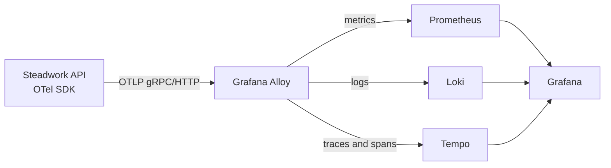

# Local observability: start here

This guide shows how to start Steadwork with its local observability tools, inspect seeded and live activity graphs, create a visible application error, and follow that request from its metric to its trace and log. The app and observability services start together with the normal local commands.


## 1. Start Steadwork

Install Docker Compose, Node.js/npm, and [uv](https://docs.astral.sh/uv/). From the repository root, run:

```sh
make run
```

The first run installs app dependencies and creates the local database schema. Then it starts the frontend, API, and the separate observability Compose project. The terminal prints the app and Grafana URLs. Keep it open while you work; press **Ctrl+C** to stop everything. The observability containers stop with the app, and their stored data is kept.

Open these pages while `make run` is active:

| Go to | What you see | Why it helps |
| --- | --- | --- |
| [Steadwork](http://127.0.0.1:5173) | The application | Make normal user requests that produce telemetry. |
| [Grafana](http://127.0.0.1:3000) | Dashboards, logs, traces, and alerts | The main place to inspect what the app did. Sign in as `admin`; the generated password is in the ignored local file `observability/.env`. |
| [Prometheus](http://127.0.0.1:9090) | Raw metrics and PromQL | Check whether request and user-action metrics are arriving. |
| [Alloy](http://127.0.0.1:12345) | Collector component status and graph | Check whether Alloy received and forwarded telemetry. |

The API is at [http://127.0.0.1:8000/api/](http://127.0.0.1:8000/api/). Grafana, Prometheus, and Alloy listen on this computer only. Loki and Tempo are reached through Grafana and are not published as host ports.

To run the containerized app and observability project together instead, copy `.env.example` to `.env`, replace the local database password, and run `make compose-up`. Stop both projects with `make compose-down`. `make run` is the simple host-development route; both routes start observability automatically. The data remains in Docker volumes after stopping. To erase all local telemetry and database data deliberately, run `docker compose --project-name steadwork-observability --env-file observability/.env --file observability/compose.yaml down --volumes` and, if using the container app, `docker compose --project-name steadwork --file docker-compose.yaml down --volumes`.

## 2. Understand the path telemetry takes

The app sends OpenTelemetry traces, metrics, and correlated logs to Alloy over OTLP. Alloy routes each signal to its local Grafana backend. Grafana reads those backends to display dashboards and link a trace to its logs.



The same containerized app can send OTLP to a collector in Docker Compose or, later, a collector running in Kubernetes. Change the OTLP endpoint and credentials for the environment; the app instrumentation does not depend on which collector or platform receives it. Each signal carries service name `steadwork-api`, environment (default `development`), and version (default `local`). The health endpoint is excluded from request telemetry so health polling does not dominate the user traffic view.

## 3. Find a request in Grafana

Open [Grafana](http://127.0.0.1:3000). The Steadwork service overview is configured as Grafana's default home dashboard. You can also open it directly at <http://127.0.0.1:3000/d/steadwork-overview/steadwork-service-overview> or via **Dashboards → Steadwork → Steadwork service overview**. The dashboard opens with request rate, 5xx share, p95 request duration, action outcomes, the **30-day request success SLI** stat, and **Successful tracked actions (rolling 24h)**. This last graph derives successful registration, login, application, withdrawal, review, and job-status activity from persisted history; its legend separates demo and live. It is not a fabricated HTTP request counter. The SLI stat is the share of eligible requests not returning 5xx; the 99% threshold is green and lower values are red. Three dedicated rolling 24-hour graphs show **Registrations and logins**, **Applications submitted, withdrawn, rejected**, and **Job and saved-job activity** (published jobs, saves/unsaves, and external apply clicks). Their legends distinguish `demo` from `live`. Lower on the page are daily/weekly event totals, registered and active users, published/saved job totals, average applications per applying candidate, and recent logs. Business activity panels use stored events and rolling-window gauge metrics, so local demo history appears on the first start and live actions update it afterward. The RED request graphs and action-outcome graph reflect actual requests and may be empty until requests occur. Use the **Environment**, **Deployed version**, and **Activity origin** selectors to filter the dashboard. The version list updates for the selected environment; choose **All** to compare versions or origins. The dashboard JSON is mounted and provisioned by `observability/compose.yaml` and `observability/grafana/provisioning/dashboards/dashboards.yaml`, so the graphs appear automatically when Grafana starts with `make run`, `make dev`, or `make compose-up`.

To inspect each signal directly, choose **Explore** and select:

- **Prometheus** for RED metrics: request **Rate**, **Errors**, and **Duration**. For example, run `sum(rate(http_server_duration_milliseconds_count{service_name="steadwork-api",deployment_environment_name="development"}[5m]))` for request rate, or `sum(rate(http_server_duration_milliseconds_count{service_name="steadwork-api",deployment_environment_name="development",http_status_code=~"5.."}[5m]))` for server errors.
- **Loki** for application logs. Search `{service_name="steadwork-api"}`. Action logs contain an `action`, an `outcome`, and `trace_id`; do not expect email addresses, resumes, or other user data in telemetry.
- **Tempo** for traces and spans. Search by service name `steadwork-api`, or paste a trace ID found in a Loki log. A trace is the end-to-end request; spans show its individual operations.


The custom counter `steadwork_user_action_total` has bounded `action` and `outcome` labels and counts real requests only. Instrumented actions include registration, login, application submission, withdrawal, job creation/status changes, and application review. Outcomes include success, expected user-visible failures such as `duplicate_email`, and `server_error`.

Live business events increment `steadwork_business_event_total`, with bounded `event`, `role`, `application_method`, and `origin` labels. Real requests use `origin=live`. Events include `user_registered`, `login_succeeded`, `job_published`, `application_submitted`, `application_withdrawn`, `application_rejected`, `external_apply_clicked`, `job_saved`, and `job_unsaved`. Publication counts happen when a job is actually published, not when a draft is created. Rejections count on a transition into Rejected, not when the same status is saved again. `steadwork_business_events_rolling` is a database-backed gauge grouped by event, origin, and rolling window (`24h` or `7d`); it includes historical demo rows as well as live rows. `steadwork_user_actions_rolling` maps persisted successful business events to the matching tracked action name and reports rolling counts by action, outcome, and origin. It only represents successes; actual request failures and expected error outcomes remain in `steadwork_user_action_total` and are never seeded. Explore daily totals with `sum by (event, origin) (steadwork_business_events_rolling{window="24h"})`, or weekly totals with `sum by (event, origin) (steadwork_business_events_rolling{window="7d"})`.

Database-backed gauges report `steadwork_users` by role, `steadwork_published_jobs`, `steadwork_saved_jobs`, distinct users with a successful login in rolling 24-hour and 7-day windows (`steadwork_active_users`), and mean applications per candidate who applied in those windows (`steadwork_applications_per_active_candidate`). The average is aggregate; individual per-user metrics are not exported. Individual user, job, and application IDs are stored only in the activity history for internal aggregate analysis. The append-only `activity_events` table does not store names, emails, resume names, or request bodies. Set an appropriate retention policy before using this data at larger scale.

User IDs, emails, job IDs, and trace IDs are never metric labels, to avoid exposing personal data and creating high-cardinality metrics. Automatic HTTP spans can contain request paths, so do not put personal information in URLs or query parameters and review any new span attributes before adding them.

## 4. Make the duplicate-registration error happen

This is a safe, repeatable local error: the first registration succeeds; submitting the same email again returns HTTP 409 and records the `duplicate_email` outcome. It does not require deliberately breaking the database or changing production data.

With the local API running, submit a unique test address twice. This example uses `curl` and the registration endpoint:

```sh
curl -i http://127.0.0.1:8000/api/auth/register/ \
  -H 'Content-Type: application/json' \
  -d '{"email":"otel-demo@example.test","password":"Local-test-password-42","name":"Demo","role":"candidate"}'
```

The first response should be `201`. Repeat the same command; the response should be `409`. If the API expects a different registration body in a future version, use the registration form in the app twice with the same address; the expected result is the same. The test `backend/api/tests/test_telemetry.py` verifies both the successful and duplicate outcomes.


Wait a few seconds for the metric export interval, then:

1. In Grafana **Explore → Prometheus**, query `steadwork_user_action_total{action="register",outcome="duplicate_email"}`. Its value should increase after each duplicate submission.


2. In **Explore → Loki**, search `{service_name="steadwork-api"} |= "duplicate_email"`. Open a matching log line and copy its 32-character `trace_id`.


3. In **Explore → Tempo**, search for service `steadwork-api` or paste that trace ID. Open the trace and inspect its request spans.


4. From the trace details, use **Logs for this span** to open the Loki records carrying the same trace ID. From the Loki record, use its trace link to return to the Tempo trace. This checks both directions of trace-to-log correlation.


Grafana is provisioned with Tempo-to-Loki and Loki-to-Tempo links. The trace ID is a log field used for the link, not a Loki stream label.

## 5. Test the local alert

There are two provisioned rules under **Alerting → Alert rules**:

- **Repeated application submission failures** is the operational rule. It fires when at least three server-side submission failures occur in ten minutes and remain present for five minutes.
- **Local smoke test - duplicate registrations** is a test-only rule. It is paused initially so expected duplicate-email behavior does not create a permanent alert.


To prove the alert path works, unpause **Local smoke test - duplicate registrations** in Grafana, then submit the same registration address enough times to produce at least three duplicate attempts within five minutes. Wait for the one-minute evaluation. The rule should enter **Firing**. Pause it again after verifying. This verifies rule evaluation in Grafana; no notification contact point is configured by default. To receive email or another notification, configure a contact point and notification policy in **Alerting**.

The request success SLI is `1 - (5xx requests / eligible requests)` over a rolling 30-day window. The numerator counts Steadwork API requests whose `http_status_code` is 5xx; the denominator counts all Steadwork API HTTP requests from `http_server_duration_milliseconds_count`, selected with `service_name="steadwork-api"`. Health checks are excluded. A 4xx response, including expected validation, authorization, and duplicate-registration failures, counts as a successful response for this availability SLI. The **30-day request success SLI** stat displays the resulting proportion; the neighboring 5xx-ratio graph displays its inverse. If there have been no eligible requests, the SLI panel shows no data rather than reporting 100%. A provisional 99% monthly objective leaves a 1% error budget (about 7 hours 12 minutes in a 30-day month). Review the objective against real user needs before treating it as a commitment. Demo activity does not create HTTP requests and does not affect the SLI or operational alert rules.

To make a new dashboard in Grafana, open **Dashboards → New → New dashboard**, add a visualization, choose a data source, enter a PromQL or LogQL query, then save it. For this repository, also save the dashboard JSON under `observability/grafana/dashboards/` so it is backed up and can be provisioned again. To make an alert, open **Alerting → Alert rules → New alert rule**, select Prometheus, enter the query and firing threshold, then add service/environment/version/owner labels and a dashboard link annotation. Configure a **Contact point** and **Notification policy** under Alerting to send the firing alert to email or another destination; without those, Grafana shows the firing state but does not notify you.

## 6. Change settings or keep dashboard edits

The local Grafana password is randomly generated once and stored in the ignored file `observability/.env`. Do not commit that file. The observability Compose project has persistent volumes for Alloy, Prometheus (15 days), Loki (7 days), Tempo (24 hours), and Grafana. The short trace retention is intentional for a local MVP; it can be changed in `observability/tempo/tempo.yaml`.

The stack settings live under `observability/`: `alloy/config.alloy`, each backend's config, and Grafana datasource, dashboard, and alert provisioning. The dashboard is editable in Grafana; edit `observability/grafana/dashboards/steadwork-overview.json` as well if you want changes to survive reprovisioning. A rule change belongs in `observability/grafana/provisioning/alerting/alert-rules.yaml`. Local `make run`, `make dev`, and `make compose-up` enable deterministic demo activity by default through `STEADWORK_SEED_OBSERVABILITY_DATA=true`. The backend only creates it when `STEADWORK_ENVIRONMENT` is `development` or `local`. It adds synthetic, clearly marked `origin=demo` history for the charted business actions and one saved-job relation; it does not emit fake request counters, traces, or logs. The E2E stack disables the seed. To disable it for host development, run `make run STEADWORK_SEED_OBSERVABILITY_DATA=false`; for Compose, set `STEADWORK_SEED_OBSERVABILITY_DATA=false` in the root `.env`. The seed is additive and idempotent for an existing local database; it does not replace your accounts, jobs, or activity history.

For local overrides, set `STEADWORK_ENVIRONMENT` and `STEADWORK_VERSION` when starting the app. For a remote OTLP collector, configure `OTEL_EXPORTER_OTLP_ENDPOINT`, `OTEL_EXPORTER_OTLP_HEADERS`, and `OTEL_EXPORTER_OTLP_PROTOCOL` in the runtime environment. Put credentials in deployment secrets, not in source control. The Render deployment is intentionally not instrumented in this MVP. Add Grafana Cloud as a later task: Render can send outbound OTLP over HTTPS, but the hosted endpoint, secret handling, and any outbound bandwidth cost need to be configured and reviewed first.

## 7. Run the telemetry tests

From the repository root:

```sh
cd backend && uv run pytest api/tests/test_telemetry.py -q
```

The tests verify that duplicate registration is returned as a 409 and recorded as an expected action outcome, and that an unexpected server exception is counted and re-raised. Run the full backend suite with `cd backend && uv run pytest -q`. The isolated browser E2E stack disables OTLP so it does not depend on this local observability project.
